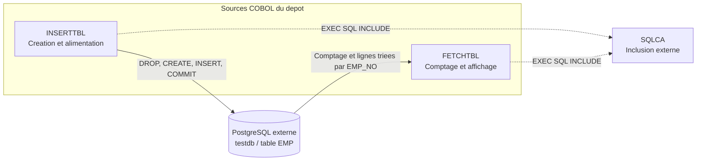

# Documentation technique COBOL — initialisation et consultation de la table EMP

## Table des matières

- [1. Introduction](#1-introduction)
- [2. Cartographie des liens entre programmes](#2-cartographie-des-liens-entre-programmes)
- [3. Analyse détaillée par fichier](#3-analyse-détaillée-par-fichier)
- [4. Fichiers principaux à retenir](#4-fichiers-principaux-à-retenir)

## 1. Introduction

### 1.1. Contexte et périmètre

Le dépôt contient deux sources COBOL : `INSERTTBL.cbl` et `FETCHTBL.cbl`. Leurs en-têtes les présentent comme des exemples **Open Cobol ESQL (Ocesql)**. Ils mettent en œuvre du SQL embarqué, avec des messages d'erreur faisant explicitement référence à PostgreSQL.

L'ensemble forme un petit scénario cohérent de préparation puis de consultation de données : les deux programmes utilisent la même base logique `testdb`, le même utilisateur `postgres` et la même table `EMP`. Il ne s'agit pas d'une application de gestion de paie : aucune règle de calcul salarial n'est implémentée.

Cette documentation repose exclusivement sur les sources présentes. Les rôles architecturaux et l'ordre d'utilisation proposés constituent une **interprétation technique** des opérations observées, et non une orchestration livrée avec le dépôt.

### 1.2. Description fonctionnelle succincte

| Programme | Responsabilité visible | Entrées et sorties |
|---|---|---|
| `INSERTTBL` | Supprimer la table `EMP` si elle existe, la recréer et y insérer un jeu de démonstration. | Données inscrites dans le source ; écritures SQL ; messages par `DISPLAY`. |
| `FETCHTBL` | Compter les lignes de `EMP`, puis afficher leurs identifiants, noms et salaires dans l'ordre des identifiants. | Lecture SQL de `EMP` ; restitution tabulaire par `DISPLAY`. |

Chaque source définit son propre `PROGRAM-ID`, un paragraphe principal `MAIN-RTN`, un paragraphe local `ERROR-RTN` et une terminaison par `STOP RUN`. Aucun passage de paramètres par `LINKAGE SECTION`, aucune saisie par `ACCEPT` et aucun accès à un fichier COBOL ne sont présents.

## 2. Cartographie des liens entre programmes

### 2.1. Répartition des rôles

| Catégorie architecturale | Programme | Justification |
|---|---|---|
| Programme de base : préparation du support de données | `INSERTTBL` | Contient le DDL de `EMP` et son alimentation initiale. Ce rôle est une classification fonctionnelle, pas un statut de programme appelé. |
| Programme intermédiaire | Aucun dans le dépôt | Aucun lanceur, sous-programme de service ou traitement de transformation entre les deux programmes n'est défini. |
| Programme spécialisé : consultation | `FETCHTBL` | Effectue le comptage et la restitution ordonnée au moyen d'un curseur SQL. |

Le couplage est **indirect, par les données persistées**, et non par des appels COBOL. Aucun `CALL` ne relie les programmes. Les `PERFORM ERROR-RTN` ciblent des paragraphes locaux, dupliqués dans chaque source ; ils ne constituent pas un service partagé.

### 2.2. Schéma des dépendances

Les traits pleins représentent les échanges fonctionnels avec les données ; les pointillés représentent les dépendances d'inclusion. **Aucune flèche ne représente un appel interprogramme.**

Un scénario nominal consiste à exécuter `INSERTTBL`, puis `FETCHTBL` après validation des insertions. Cet ordre est déduit du contrat de données : aucun script ne le met en œuvre. `FETCHTBL` peut également lire une table `EMP` compatible préparée autrement.

**Attention : `INSERTTBL` n'est pas un chargement incrémental.** Son `DROP TABLE IF EXISTS EMP` supprime la table existante dans la transaction ; l'exécution ne doit pas être assimilée à une simple consultation ou à un ajout de lignes.

### 2.3. Contrat de données partagé

La définition de référence est portée par le `CREATE TABLE` de [INSERTTBL.cbl, lignes 85–94](INSERTTBL.cbl#L85-L94).

| Colonne | Définition SQL | Variables hôtes des deux programmes |
|---|---|---|
| `EMP_NO` | `NUMERIC(4,0) NOT NULL` ; clé primaire `IEMP_0`. | `EMP-NO PIC S9(04)`. |
| `EMP_NAME` | `CHAR(20)` ; aucune contrainte `NOT NULL`. | `EMP-NAME PIC X(20)`. |
| `EMP_SALARY` | `NUMERIC(4,0)` ; aucune contrainte `NOT NULL`. | `EMP-SALARY PIC S9(04)`. |

Les insertions fournissent les trois valeurs dans l'ordre des colonnes du DDL, sans liste de colonnes explicite. Le lecteur les sélectionne explicitement et applique `ORDER BY EMP_NO`. Une modification du schéma doit donc préserver à la fois les correspondances de types et l'ordre attendu par les insertions.

Aucun indicateur SQL de nullité n'accompagne les variables hôtes. Le DDL autorise pourtant `NULL` pour le nom et le salaire : leur lecture n'est pas explicitement prise en charge par ces sources. Le comportement précis dépend de la couche SQL externe.

La table est référencée sans qualification de schéma. Les paramètres de résolution du schéma et le niveau d'isolation transactionnelle ne sont pas définis dans le code ; la cohérence du comptage avec le parcours en présence de modifications concurrentes n'est donc pas établie par le dépôt.

### 2.4. Références à des éléments absents du dépôt

| Élément externe | Référence dans les sources | Portée et limite du constat |
|---|---|---|
| `SQLCA` | `EXEC SQL INCLUDE SQLCA` dans les deux programmes. | Inclusion SQL absente du dépôt ; les sources utilisent `SQLCODE`, `SQLSTATE` et `SQLERRMC`, dont la déclaration n'est pas livrée. |
| Base `testdb` et service PostgreSQL | `CONNECT` avec variables hôtes ; branche d'erreur libellée `PostgreSQL error`. | Aucun serveur, création de base, paramétrage réseau ou configuration d'authentification n'est fourni. |
| Chaîne Open Cobol ESQL / Ocesql | En-têtes et blocs `EXEC SQL`. | Une chaîne prenant en charge le SQL embarqué est une dépendance technique déduite des sources. Préprocesseur, bibliothèques, commandes et versions ne sont pas fournis. |
| Table persistée `EMP`, pour le lecteur | `SELECT COUNT(*)` et curseur de `FETCHTBL`. | Sa création est codée dans `INSERTTBL`, mais sa présence effective dans la base n'est pas garantie par les fichiers du dépôt. |

Aucun appel explicite à un programme COBOL externe n'est présent. Il ne faut pas confondre l'inclusion `SQLCA` avec un `CALL`, ni inventer les appels de bibliothèque que pourrait produire une précompilation absente du dépôt.

### 2.5. Connexion et traitement des états SQL

Dans les deux programmes, `DBNAME PIC X(30)` reçoit `testdb`, `USERNAME PIC X(30)` reçoit `postgres` et `PASSWD PIC X(10)` reçoit des espaces juste avant `CONNECT`. Ces paramètres sont codés en dur ; aucune lecture de configuration n'est implémentée. La valeur de `PASSWD` ne permet pas de conclure que le serveur autorise une connexion sans mot de passe.

Les deux paragraphes `ERROR-RTN` effectuent un `EVALUATE SQLCODE` identique :

| Valeur testée | Traitement codé |
|---|---|
| `+10` | Affichage d'un message d'enregistrement non trouvé. |
| `-01` | Affichage d'un message d'échec de connexion. |
| `-20` | Affichage d'un message d'erreur interne. |
| `-30` | Affichage d'une erreur PostgreSQL, de `SQLSTATE` et `SQLERRMC`, puis `ROLLBACK`. |
| Autre valeur | Affichage d'une erreur non définie, de `SQLSTATE` et `SQLERRMC` ; aucun `ROLLBACK`. |

Ces valeurs sont celles **testées par les programmes**, et non une spécification générale des codes PostgreSQL. La directive `WHENEVER SQLERROR PERFORM ERROR-RTN` est commentée : seuls les contrôles explicites appellent le gestionnaire.

Les deux parcours nominaux exécutent `COMMIT WORK`, puis `DISCONNECT ALL`. Aucun de ces résultats n'est contrôlé. Les messages `FINISHED` ne prouvent donc pas le succès de toutes les opérations. Le `ROLLBACK` n'est ni systématique ni suivi d'un mécanisme de reprise ou de nouvelle tentative.

Références : [INSERTTBL.cbl, lignes 69–76](INSERTTBL.cbl#L69-L76), [lignes 137–160](INSERTTBL.cbl#L137-L160) ; [FETCHTBL.cbl, lignes 48–55](FETCHTBL.cbl#L48-L55), [lignes 111–134](FETCHTBL.cbl#L111-L134).

## 3. Analyse détaillée par fichier

### 3.1. INSERTTBL.cbl

**Nom du programme :** `INSERTTBL`.

**Objectif fonctionnel :** préparer intégralement la table de démonstration `EMP`, puis tenter deux insertions littérales et dix insertions par variables hôtes. Si toutes les opérations réussissent et sont validées, le jeu produit comprend douze lignes, d'identifiants `1` à `10`, `46` et `47`.

**Structures clés** — [lignes 19–59](INSERTTBL.cbl#L19-L59) :

| Structure | Définition et rôle |
|---|---|
| `TEST-DATA` | Dix littéraux actifs `PIC X(28)`, soit 280 octets de données initialisées. Les alternatives à noms latins sont commentées et ne sont pas exécutées. |
| `TEST-DATA-R` / `TEST-TBL` | `REDEFINES TEST-DATA` avec `OCCURS 10` ; chaque occurrence superpose `TEST-NO PIC S9(04)`, `TEST-NAME PIC X(20)` et `TEST-SALARY PIC S9(04)`. |
| `IDX` | `PIC 9(02)` ; indice utilisé pour parcourir les dix occurrences. |
| `DBNAME`, `USERNAME`, `PASSWD` | Variables hôtes de connexion, placées dans la section de déclaration SQL. |
| `EMP-REC-VARS` | Groupe des trois variables hôtes alimentées avant chaque insertion dans la boucle. |
| `SYS-TIME` | `PIC 9(08)` déclaré mais jamais utilisé ; aucune fonction d'horodatage n'est implémentée. |

**Déroulement et contrôles** — [lignes 63–134](INSERTTBL.cbl#L63-L134) :

| Étape | Opération | Réaction explicite à un `SQLCODE` non nul |
|---|---|---|
| Connexion | `CONNECT` à partir des paramètres fixes. | `ERROR-RTN`, puis `STOP RUN` ; le chemin normal de déconnexion n'est pas atteint. |
| Suppression | `DROP TABLE IF EXISTS EMP`. | `ERROR-RTN`, puis poursuite vers la création. |
| Création | `CREATE TABLE EMP` et clé primaire `IEMP_0`. | `ERROR-RTN`, puis `STOP RUN`. |
| Insertions littérales | Deux `INSERT`, identifiants `46` et `47`, salaires `-320` et `480`. | `ERROR-RTN` après chaque échec ; le traitement suivant reste exécuté. |
| Insertions par variables hôtes | `PERFORM VARYING IDX FROM 1 BY 1 UNTIL IDX > 10` ; trois `MOVE`, puis un `INSERT` par occurrence. | `ERROR-RTN`, puis `EXIT PERFORM` : seule la boucle est quittée. |
| Finalisation | `COMMIT WORK`, `DISCONNECT ALL`, message de fin, `STOP RUN`. | Aucun contrôle de résultat. |

Une erreur d'insertion ne déclenche donc pas systématiquement l'arrêt du programme. Après une sortie anticipée de boucle, le code atteint encore `COMMIT` et le message de fin. Si le gestionnaire effectue un `ROLLBACK`, il n'y a pas de reconstruction automatique de la table ni de réinsertion des lignes précédentes ; le contenu final ne peut pas être déduit du seul message de terminaison.

**Mécanismes COBOL :** source à présentation fixe, données en `WORKING-STORAGE`, réinterprétation mémoire par `REDEFINES`, tableau `OCCURS`, parcours indicé par `PERFORM VARYING`, transferts par `MOVE`, SQL embarqué avec variables hôtes préfixées par `:`, contrôles `IF`, appel local par `PERFORM` et sélection par `EVALUATE`.

**Encodage et représentation :** les octets de ce fichier ne constituent pas un texte UTF-8 valide ; aucun encodage source n'est déclaré dans le dépôt. Les littéraux actifs de `TEST-DATA` ont chacun 28 octets, selon le découpage 4/20/4. Des suffixes tels que `025p` sont superposés aux champs numériques signés `PIC S9(04)` : leur interprétation dépend de la convention de représentation du signe de la chaîne COBOL. Il ne faut ni remplacer ces suffixes arbitrairement, ni déduire les noms réellement insérés des variantes latines commentées.

**Relation avec les autres programmes :** ce programme fournit le schéma et les données consommables par `FETCHTBL`. Il ne l'appelle pas et ne lui transmet aucun état mémoire ; seule la base peut porter l'état partagé.

### 3.2. FETCHTBL.cbl

**Nom du programme :** `FETCHTBL`.

**Objectif fonctionnel :** consulter une table `EMP` déjà présente, afficher son nombre de lignes, puis restituer les trois colonnes par ordre croissant de `EMP_NO`. Aucune création de table, insertion ou mise à jour n'est effectuée.

**Structures clés** — [lignes 20–38](FETCHTBL.cbl#L20-L38) :

| Structure | Définition et rôle |
|---|---|
| `DBNAME`, `USERNAME`, `PASSWD` | Variables hôtes de connexion identiques à celles du chargeur. |
| `EMP-REC-VARS` | Réception d'une ligne : `EMP-NO PIC S9(04)`, `EMP-NAME PIC X(20)`, `EMP-SALARY PIC S9(04)`. |
| `EMP-CNT` | `PIC 9(04)` ; réception du résultat de `COUNT(*)`. Capacité de représentation de 0 à 9999, sans traitement de dépassement explicite. |
| `D-EMP-REC` | Groupe d'affichage : numéro `PIC 9(04)`, nom `PIC X(20)`, salaire édité `PIC --,--9`, et deux séparateurs `FILLER PIC X`. |
| `C1` | Curseur SQL sélectionnant les trois colonnes de `EMP` avec `ORDER BY EMP_NO` ; ce n'est pas un tableau COBOL. |

**Déroulement** — [lignes 42–108](FETCHTBL.cbl#L42-L108) :

1. Renseigner les paramètres fixes et ouvrir la connexion.
2. Exécuter `SELECT COUNT(*) INTO :EMP-CNT FROM EMP`, puis afficher le total.
3. Déclarer et ouvrir `C1`, afficher les en-têtes, puis effectuer un premier `FETCH`.
4. Tant que `SQLCODE` vaut zéro, transférer les variables hôtes vers `D-EMP-REC`, afficher le groupe et effectuer le `FETCH` suivant.
5. Fermer `C1`, exécuter `COMMIT WORK`, se déconnecter et terminer.

**Mécanismes COBOL :** variables hôtes SQL, curseur déclaré par `EXEC SQL DECLARE`, amorçage de lecture avant une boucle `PERFORM UNTIL`, transferts `MOVE`, édition numérique du salaire et restitution par `DISPLAY`. Le paragraphe `ERROR-RTN` utilise le même `EVALUATE` que celui du chargeur, sans mutualisation du code.

**Limites du contrôle SQL :** seule la connexion est suivie d'un appel explicite à `ERROR-RTN`, avec arrêt en cas d'échec. Le comptage, l'ouverture, la fermeture, la validation et la déconnexion ne sont pas contrôlés. Tout `SQLCODE` non nul après un `FETCH` fait sortir de la boucle, sans distinction explicite entre fin des données et erreur, et sans appel au gestionnaire. Un message de fin peut donc suivre un parcours interrompu par une erreur SQL.

**Contraintes de restitution :** le numéro est reçu dans un champ signé mais affiché dans un champ non signé ; le salaire est édité selon le masque COBOL, sans calcul métier. La longueur des champs et l'absence d'indicateurs de nullité imposent le contrat décrit en section 2.3.

**Relation avec les autres programmes :** `FETCHTBL` dépend de la présence et de la compatibilité de `EMP`, pas de l'exécution technique d'`INSERTTBL`. Il partage avec lui les noms de colonnes et la configuration de connexion, mais aucune routine ni structure mémoire à l'exécution.

## 4. Fichiers principaux à retenir

### 4.1. Fichiers autres que .cbl ou .cpy

Hors du présent document, le dépôt analysé ne contient aucun fichier autre que les deux sources `.cbl`. Aucun fichier `.cpy` n'est fourni.

| Fichier | Rôle |
|---|---|
| `documentation COBOL.md` | Documentation de l'architecture, du contrat de données, des traitements et des dépendances observables dans les sources. |

### 4.2. Éléments de réalisation non fournis

Aucun README, script SQL séparé, script d'exécution, Makefile, job JCL, fichier de configuration, test ou binaire n'est livré. Le schéma SQL et le jeu de données sont intégrés dans `INSERTTBL.cbl` ; `SQLCA` reste une dépendance externe.

Le dépôt ne permet donc pas d'établir une procédure reproductible de précompilation, compilation, édition de liens ou déploiement. Les options de la chaîne COBOL/SQL, l'encodage exact des données et la configuration du serveur doivent être établis hors de ce périmètre avant une exécution ; aucune commande ou version n'est supposée ici.
