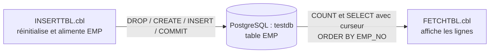

# Documentation technique de l'ensemble COBOL

## Table des matières

- [1. Introduction](#1-introduction)
  - [Contexte](#contexte)
  - [Description fonctionnelle succincte](#description-fonctionnelle-succincte)
- [2. Cartographie des liens entre programmes](#2-cartographie-des-liens-entre-programmes)
  - [Positionnement architectural](#positionnement-architectural)
  - [Flux fonctionnel](#flux-fonctionnel)
  - [Dépendances externes au dépôt](#dépendances-externes-au-dépôt)
- [3. Analyse détaillée par fichier](#3-analyse-détaillée-par-fichier)
  - [INSERTTBL.cbl](#inserttblcbl)
  - [FETCHTBL.cbl](#fetchtblcbl)
- [4. Fichiers principaux à retenir](#4-fichiers-principaux-à-retenir)

## 1. Introduction

### Contexte

Le dépôt contient deux programmes COBOL : `INSERTTBL.cbl` et `FETCHTBL.cbl`. Leurs commentaires les présentent comme des exemples Open Cobol ESQL (Ocesql), datés du 28 juin 2013. Ils utilisent tous deux des blocs `EXEC SQL` et se connectent à une base PostgreSQL nommée `testdb`.

L'architecture observable est volontairement réduite : deux programmes avec leur propre `PROGRAM-ID` et leur propre `PROCEDURE DIVISION`, sans programme d'orchestration COBOL, copybook ou configuration de build présent dans le dépôt. Leur cohérence fonctionnelle repose sur la table `EMP` de la base de données, et non sur des appels directs entre programmes.

### Description fonctionnelle succincte

`INSERTTBL` supprime puis recrée la table `EMP`, y insère deux lignes définies dans des instructions SQL et dix lignes préparées dans la Working-Storage, puis valide la transaction. `FETCHTBL` compte ensuite les lignes de `EMP`, les lit avec un curseur trié par numéro d'employé et les affiche.

La séquence `INSERTTBL` puis `FETCHTBL` constitue le flux fonctionnel suggéré par ces opérations. Aucun mécanisme du dépôt ne lance ou n'impose cette séquence.

## 2. Cartographie des liens entre programmes

### Positionnement architectural

| Niveau | Programmes présents | Constat |
|---|---|---|
| Socle ou programmes de base réutilisables | Aucun identifié | Aucun service COBOL partagé, copybook ou module de base n'est fourni. |
| Programmes intermédiaires ou d'orchestration | Aucun identifié | Aucun programme ne coordonne les deux traitements et aucun `CALL` COBOL n'est visible. |
| Programmes applicatifs spécialisés | `INSERTTBL`, `FETCHTBL` | Ce sont les deux points d'entrée observables : l'un initialise les données, l'autre les consulte. |

### Flux fonctionnel

Le lien entre les programmes est indirect et persistant : ils accèdent à la même table `EMP`. La dépendance d'exécution de `FETCHTBL` envers les données produites par `INSERTTBL` est une interprétation du flux SQL ; elle n'est pas matérialisée par un appel ou un ordonnanceur dans le code.

### Dépendances externes au dépôt

- **SQLCA** : les deux sources contiennent `EXEC SQL INCLUDE SQLCA END-EXEC` et utilisent `SQLCODE`, `SQLSTATE` et `SQLERRMC`. Aucun fichier `SQLCA` ou `.cpy` correspondant n'est livré ; sa fourniture par l'environnement Ocesql est attendue, sans configuration présente dans le dépôt pour le confirmer.
- **Ocesql / traitement ESQL** : les commentaires des sources identifient Ocesql et les instructions `EXEC SQL` impliquent un environnement capable de les traiter. Aucun script de précompilation ou de compilation n'est fourni.
- **PostgreSQL et `testdb`** : les programmes ouvrent une connexion à cette base avec `USERNAME` initialisé à `postgres` et `PASSWD` à l'espace. La base et le service PostgreSQL ne sont pas définis dans le dépôt.
- **Appels à des programmes externes** : aucun `CALL` COBOL n'est présent ; aucun programme appelé manquant n'est donc identifiable. Les interactions externes visibles sont les instructions SQL et l'inclusion SQLCA.

## 3. Analyse détaillée par fichier

### INSERTTBL.cbl

#### Nom et objectif fonctionnel

- **Programme COBOL** : `INSERTTBL` (`PROGRAM-ID. INSERTTBL`).
- **Objectif** : démontrer la création et le chargement de la table `EMP`. Chaque exécution commence par `DROP TABLE IF EXISTS EMP`, puis recrée la table ; les données existantes dans cette table sont donc remplacées.
- **Données chargées** : deux lignes via des valeurs SQL littérales, puis dix lignes via des variables hôtes COBOL.

#### Structures clés

- `TEST-DATA` contient dix enregistrements littéraux de longueur fixe (`PIC X(28)`).
- `TEST-DATA-R REDEFINES TEST-DATA` redécrit ces données sous la forme d'un tableau `TEST-TBL OCCURS 10`, composé des champs `TEST-NO`, `TEST-NAME` et `TEST-SALARY`.
- `EMP-REC-VARS` regroupe les variables hôtes `EMP-NO`, `EMP-NAME` et `EMP-SALARY`, utilisées par l'insertion paramétrée.
- `IDX` pilote le parcours des dix lignes. `SYS-TIME` est déclaré mais n'est pas utilisé dans le traitement visible.
- La table créée comporte `EMP_NO NUMERIC(4,0) NOT NULL`, `EMP_NAME CHAR(20)` et `EMP_SALARY NUMERIC(4,0)`, avec une clé primaire sur `EMP_NO` nommée `IEMP_0`.

#### Mécanismes COBOL et SQL

Le programme connecte `testdb`, exécute le DDL de suppression et de création, insère les deux lignes littérales, puis parcourt `TEST-TBL` avec `PERFORM VARYING`. Les valeurs sont copiées vers les variables hôtes avant chaque `INSERT`. La transaction est ensuite validée par `COMMIT WORK`, et la connexion est fermée par `DISCONNECT ALL`.

La gestion des erreurs est manuelle : `WHENEVER SQLERROR` est présent uniquement sous forme de commentaire. Les vérifications de `SQLCODE` ne conduisent pas toutes au même comportement : une erreur de connexion ou de création provoque l'arrêt du programme, tandis qu'une erreur sur les insertions littérales appelle le gestionnaire puis laisse le traitement continuer. Une erreur pendant la boucle d'insertion appelle le gestionnaire et quitte la boucle, après quoi le chemin vers `COMMIT WORK` reste accessible. Dans `ERROR-RTN`, le `ROLLBACK` est exécuté dans le cas `SQLCODE = -30` ; le gestionnaire ne stoppe pas lui-même le programme.

#### Relation avec les autres programmes

`INSERTTBL` est le producteur des données de `EMP` consommées par `FETCHTBL`. Il ne l'appelle pas directement : le seul lien visible entre les deux traitements est la table PostgreSQL partagée.

### FETCHTBL.cbl

#### Nom et objectif fonctionnel

- **Programme COBOL** : `FETCHTBL` (`PROGRAM-ID. FETCHTBL`).
- **Objectif** : compter puis afficher les enregistrements de la table `EMP`, dans l'ordre croissant de `EMP_NO`.

#### Structures clés

- `EMP-REC-VARS` contient les variables hôtes `EMP-NO`, `EMP-NAME` et `EMP-SALARY` utilisées par les instructions `SELECT` et `FETCH`.
- `EMP-CNT` reçoit le résultat de `SELECT COUNT(*)`.
- `D-EMP-REC` est la structure de présentation affichée : numéro, séparateurs, nom et salaire formaté. Les valeurs récupérées y sont déplacées avant `DISPLAY`.
- SQLCA fournit les champs de statut et de diagnostic utilisés par le gestionnaire d'erreurs.

#### Mécanismes COBOL et SQL

Après connexion, le programme exécute `SELECT COUNT(*) INTO :EMP-CNT`, puis déclare et ouvre le curseur `C1` sur `EMP_NO`, `EMP_NAME` et `EMP_SALARY`, avec tri par numéro. Il effectue un premier `FETCH`, puis répète les déplacements et affichages jusqu'à ce que `SQLCODE` soit différent de zéro. Il ferme ensuite le curseur, exécute `COMMIT WORK`, déconnecte toutes les connexions et termine.

La clause `WHENEVER SQLERROR` est également commentée. Le contrôle explicite par `SQLCODE` n'est fait qu'après la connexion ; la boucle de lecture s'arrête sur tout code non nul, sans distinguer la fin normale des données d'une autre erreur SQL. Le gestionnaire `ERROR-RTN` est appelé sur l'échec de connexion, mais les erreurs sur le comptage, l'ouverture ou les lectures du curseur ne lui sont pas explicitement transmises.

#### Relation avec les autres programmes

`FETCHTBL` lit la même table `EMP` que celle créée et alimentée par `INSERTTBL`. Il n'existe aucun appel COBOL direct entre les deux programmes. La table et la base constituent leur contrat d'intégration.

## 4. Fichiers principaux à retenir

Hors du présent document de sortie, l'inventaire des fichiers du dépôt ne fait apparaître aucun fichier majeur autre que les sources `.cbl` : aucun fichier `.cpy`, script de compilation, fichier de configuration ou document de projet préexistant n'est présent.

| Fichier | Rôle |
|---|---|
| `INSERTTBL.cbl` | Création et chargement de la table PostgreSQL `EMP`. |
| `FETCHTBL.cbl` | Comptage et lecture ordonnée des lignes de `EMP`, puis affichage. |
