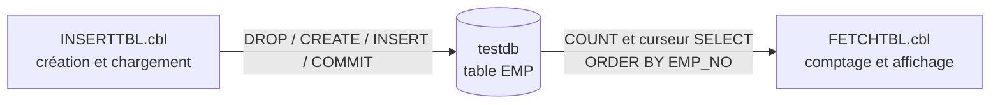

# Documentation technique — programmes COBOL

## Table des matières

- [1. Introduction](#1-introduction)
- [2. Cartographie des liens entre programmes](#2-cartographie-des-liens-entre-programmes)
- [3. Analyse détaillée par fichier](#3-analyse-détaillée-par-fichier)
  - [INSERTTBL.cbl](#inserttblcbl)
  - [FETCHTBL.cbl](#fetchtblcbl)
- [4. Fichiers principaux à retenir](#4-fichiers-principaux-à-retenir)

## 1. Introduction

### Contexte

Le périmètre applicatif analysé comprend deux sources COBOL : `INSERTTBL.cbl` et `FETCHTBL.cbl`. Leurs en-têtes les présentent comme des exemples Open Cobol ESQL (Ocesql), datés du 28 juin 2013. Ils utilisent du SQL embarqué dans des instructions `EXEC SQL` et ciblent une base nommée `testdb`.

Le dépôt ne définit pas de programme orchestrateur, de chaîne de construction ni de configuration d’environnement. L’architecture observable est donc celle de deux programmes exécutables séparément, coordonnés par les données persistées dans une table relationnelle commune.

### Description fonctionnelle succincte

`INSERTTBL` supprime, recrée et alimente la table `EMP`. Il effectue deux insertions littérales, puis tente d’insérer jusqu’à dix enregistrements définis en mémoire. `FETCHTBL` compte les lignes de `EMP`, parcourt ensuite les enregistrements dans l’ordre de `EMP_NO` et les affiche avec un formatage de présentation.

Le flux fonctionnel attendu pour lire les données d’essai est donc `INSERTTBL`, puis `FETCHTBL`. Cet ordre découle de la création de `EMP` dans le premier programme et de sa lecture dans le second ; aucun ordonnanceur ni appel de programme ne l’impose dans le dépôt.

## 2. Cartographie des liens entre programmes

### Rôles dans l’architecture

| Niveau | Programme(s) | Rôle observé |
|---|---|---|
| Points d’entrée (« base » au sens exécution) | `INSERTTBL`, `FETCHTBL` | Chacun possède son propre `PROGRAM-ID`, sa `PROCEDURE DIVISION` et termine par `STOP RUN`. |
| Intermédiaire | Aucun identifié | Aucun programme ne relaie ni ne coordonne l’appel d’un autre programme. |
| Spécialisé : écriture | `INSERTTBL` | Initialise la table `EMP` et tente d’y insérer les données de démonstration. |
| Spécialisé : lecture | `FETCHTBL` | Compte, sélectionne et affiche les lignes de `EMP`. |

Les deux programmes sont donc des points d’entrée autonomes, chacun spécialisé dans un côté du flux de données. Le lien entre eux est la table SQL, pas un appel direct de `FETCHTBL` par `INSERTTBL` ou l’inverse.

### Schéma fonctionnel

Le schéma représente un partage de données persistant. Il ne représente ni un `CALL` COBOL ni une séquence de lancement automatisée.

### Éléments externes au dépôt

- **Aucun appel COBOL `CALL` à un sous-programme** n’est présent dans les deux sources. Aucun programme appelé mais absent du dépôt n’est donc identifié.
- Les deux sources exécutent `EXEC SQL INCLUDE SQLCA`. Aucun fichier `SQLCA` ou copybook `.cpy` n’est fourni ; sa résolution dépend de l’environnement Ocesql/SQL utilisé pour la précompilation.
- Les clauses `EXEC SQL` impliquent un précompilateur ou une chaîne COBOL compatible avec Ocesql et un environnement d’exécution SQL. Les commandes et versions de ces outils ne sont pas décrites dans le dépôt.
- À l’exécution, le code demande la base `testdb` et l’utilisateur `postgres`, avec un mot de passe initialisé à des espaces. La disponibilité et la configuration du service de base de données ne sont pas fournies.
- `EMP` n’est pas un artefact externe manquant : `INSERTTBL` contient les instructions qui la suppriment et la recréent. `FETCHTBL` suppose toutefois que cette table existe au moment de son exécution.

## 3. Analyse détaillée par fichier

### INSERTTBL.cbl

**Nom du programme :** `INSERTTBL` (`PROGRAM-ID`).

#### Objectif fonctionnel

Ce programme constitue le point d’entrée de préparation et de chargement des données. Il se connecte à `testdb`, exécute `DROP TABLE IF EXISTS EMP`, crée `EMP`, puis effectue deux insertions avec des valeurs SQL littérales et jusqu’à dix insertions avec des variables hôtes. Le schéma créé comporte `EMP_NO NUMERIC(4,0) NOT NULL`, `EMP_NAME CHAR(20)` et `EMP_SALARY NUMERIC(4,0)`, avec `EMP_NO` comme clé primaire (`IEMP_0`).

#### Structures clés

- `TEST-DATA` contient les données de démonstration sous forme de littéraux fixes de 28 caractères. `TEST-DATA-R REDEFINES TEST-DATA` les interprète comme dix occurrences (`TEST-TBL`) composées d’un numéro signé sur quatre chiffres, d’un nom de 20 caractères et d’un salaire signé sur quatre chiffres.
- `IDX` pilote la boucle sur ces dix occurrences.
- `EMP-REC-VARS`, dans la section de déclaration SQL, fournit les variables hôtes `EMP-NO`, `EMP-NAME` et `EMP-SALARY` utilisées par l’instruction `INSERT`.
- `DBNAME`, `USERNAME` et `PASSWD` sont également déclarés dans la section SQL. La zone `SQLCA` est incluse pour accéder aux informations de statut SQL.

#### Mécanismes COBOL et SQL

Le programme combine `WORKING-STORAGE`, `REDEFINES`, `OCCURS`, une boucle `PERFORM VARYING` et des instructions SQL embarquées. Les paramètres de connexion sont affectés dans le code : `testdb`, `postgres` et `SPACE` pour le mot de passe. Les valeurs des deux insertions littérales sont les numéros `46` et `47`, avec des salaires respectifs de `-320` et `480`.

Après les insertions, le programme exécute `COMMIT WORK`, `DISCONNECT ALL`, affiche son message de fin et s’arrête. Le total de douze lignes est un objectif d’insertion (deux littérales et jusqu’à dix via variables hôtes), pas une garantie en cas d’erreur SQL.

La directive `WHENEVER` est présente uniquement sous forme de commentaire ; les contrôles sont donc réalisés explicitement à certains endroits. À la connexion et après la création de table, une erreur appelle `ERROR-RTN` puis arrête le programme. Une erreur au `DROP TABLE` appelle le traitement d’erreur mais laisse le flot continuer. Les erreurs des insertions littérales n’interrompent pas immédiatement le programme ; une erreur dans la boucle d’insertion des variables hôtes provoque la sortie de cette boucle.

`ERROR-RTN` affiche `SQLCODE` et, pour certains cas, `SQLSTATE` et `SQLERRMC`. Le `ROLLBACK` est exécuté dans le cas `SQLCODE -30` ; le traitement ne définit pas de stratégie uniforme de reprise pour tous les échecs. Les statuts de `COMMIT WORK` et de `DISCONNECT ALL` ne sont pas contrôlés dans le flot visible.

#### Relation avec les autres programmes

`INSERTTBL` fournit les données consommées par `FETCHTBL` via la table partagée `EMP`. Il ne lance pas `FETCHTBL` et ne lui transmet pas de paramètres. Sa réexécution tente de supprimer puis de recréer la table ; les données existantes dans `EMP` sont donc remplacées si ces opérations aboutissent.

### FETCHTBL.cbl

**Nom du programme :** `FETCHTBL` (`PROGRAM-ID`).

#### Objectif fonctionnel

Ce programme constitue le point d’entrée de consultation. Après connexion à `testdb`, il demande le nombre de lignes de `EMP`, affiche ce total, puis sélectionne `EMP_NO`, `EMP_NAME` et `EMP_SALARY` dans l’ordre croissant de `EMP_NO`. Chaque ligne est formatée et affichée.

#### Structures clés

- `EMP-REC-VARS` contient les trois variables hôtes de réception, avec des types COBOL correspondant aux colonnes lues.
- `EMP-CNT` reçoit le résultat de `SELECT COUNT(*)`.
- `C1` est un curseur déclaré sur la sélection ordonnée de `EMP`.
- `D-EMP-REC` est la zone d’affichage : numéro, séparateurs (`FILLER`), nom et salaire édité par `PIC --,--9`.
- `SQLCA` est inclus comme dans `INSERTTBL`.

#### Mécanismes COBOL et SQL

Après la connexion, le programme exécute `SELECT COUNT(*) INTO :EMP-CNT`, puis affiche la valeur. Il déclare et ouvre le curseur `C1`, effectue un premier `FETCH`, puis répète les `FETCH` et les `DISPLAY` tant que `SQLCODE` vaut zéro. Il ferme ensuite le curseur, exécute `COMMIT WORK`, se déconnecte avec `DISCONNECT ALL` et termine.

Le traitement `ERROR-RTN` n’est appelé explicitement qu’en cas d’échec de connexion. La boucle de lecture s’arrête dès que `SQLCODE` est non nul, sans distinguer explicitement la fin normale du curseur d’une autre erreur de lecture. Le code visible ne vérifie pas non plus les statuts après le comptage, l’ouverture/fermeture du curseur, le commit ou la déconnexion.

#### Relation avec les autres programmes

`FETCHTBL` lit la même table `EMP` que celle créée et alimentée par `INSERTTBL`. Il ne modifie pas les lignes dans le code visible et n’appelle aucun autre programme. Son fonctionnement dépend de l’existence de la table et, pour obtenir les données de démonstration, de l’exécution préalable réussie d’`INSERTTBL`.

## 4. Fichiers principaux à retenir

| Catégorie | Fichiers présents dans le périmètre analysé | Rôle |
|---|---|---|
| Sources COBOL | `INSERTTBL.cbl`, `FETCHTBL.cbl` | Seuls programmes applicatifs identifiés ; ils portent respectivement les traitements d’écriture et de lecture de `EMP`. |
| Copybooks (`.cpy`) | Aucun | Aucun copybook local n’est fourni. `SQLCA` est référencé, mais sa définition est externe au dépôt. |
| Documentation Markdown | `documentation COBOL.md` | Présente cette analyse et la cartographie ; livrable documentaire sans rôle à l’exécution. |
| Configuration, construction et données séparées | Aucun identifié | Aucun script de construction, fichier SQL séparé, jeu de données ni fichier de configuration n’accompagne les sources. |

Le présent document n’ajoute pas de dépendance à l’exécution des programmes.
